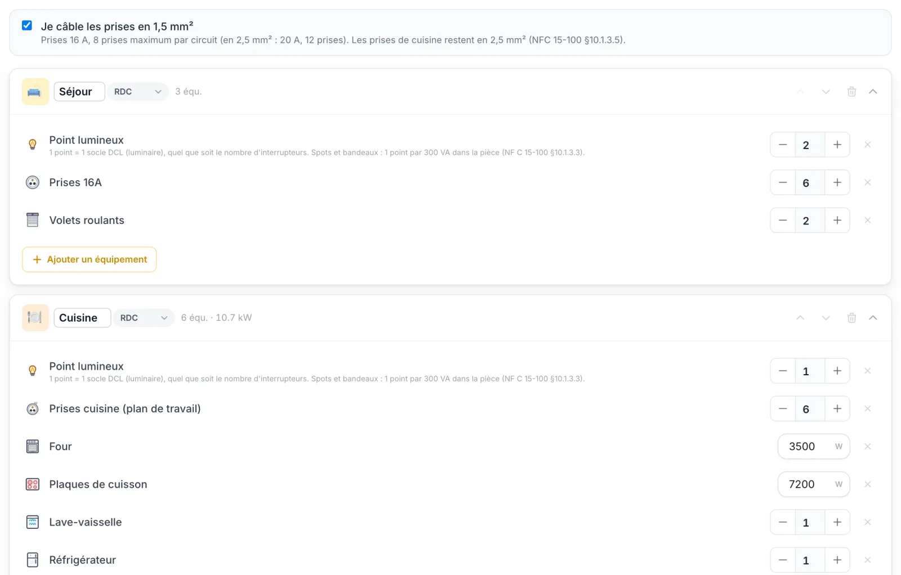
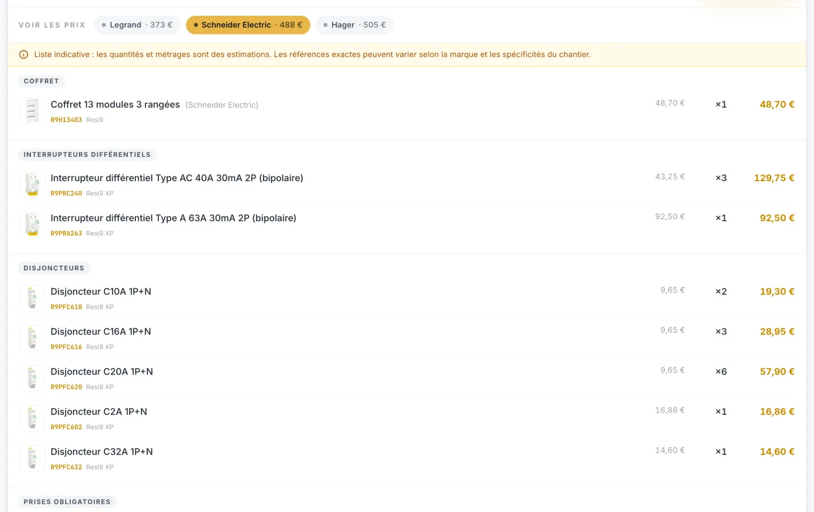

Ça fait maintenant huit mois que je développe [Lumo](https://getlumo.fr), un outil en ligne pour concevoir des tableaux électriques conformes à la NF C 15-100, accessible sur [getlumo.fr](https://getlumo.fr). Je n'en avais encore jamais parlé ici, alors que c'est sans doute le projet qui résume le mieux ma reconversion : le développement, mon métier d'origine, y rejoint l'électricité, celui que j'apprends. L'idée est née devant des vidéos d'électriciens qui dessinaient leurs tableaux au crayon. Aujourd'hui, près de 400 personnes l'utilisent. Voici d'où il vient, ce qu'il m'a appris et ce qu'il peut vous apporter, que vous rénoviez vous-même votre maison ou que vous soyez électricien.

*L'éditeur de tableau. Les modules sont dessinés comme les vrais, ici en Schneider, avec sous chacun son repère et le circuit qu'il protège. Chaque rangée indique combien de modules restent libres.*

## Au départ, un bout de carton à côté du tableau vide

Lumo n'est pas né d'une étude de marché, mais devant YouTube. Je suis plusieurs chaînes d'électricité, en particulier [Les Disjonctés](https://www.youtube.com/@lesdisjonctes) et [DIY avec POLO](https://www.youtube.com/@DIYavecPOLO), grâce à qui j'ai énormément appris. Quand ces électriciens filment la pose d'un tableau, on les voit presque toujours préparer leur répartition sur une feuille ou un morceau de carton, posé à côté du coffret encore vide. Ils listent les circuits, choisissent les calibres et les sections, répartissent le tout sous les interrupteurs différentiels, puis comptent les modules pour vérifier que ça rentre. En triphasé, il faut encore équilibrer les phases. Au moindre ajout, on rature et on recommence.

À l'époque, je n'avais encore jamais conçu de tableau moi-même. Je regardais ces vidéos avec mon œil d'ingénieur logiciel. Tout ce travail au crayon me laissait une impression tenace : il y avait quelque chose à faire. Une application pouvait prendre en charge ces calculs et vérifier la norme au passage. J'ai cherché ce qui existait. Les logiciels que j'ai trouvés étaient souvent liés à une marque de matériel, ou pensés pour des bureaux d'études plutôt que pour un artisan qui enchaîne les chantiers.

Le vrai test est venu ensuite, avec [la rénovation de ma maison dans le Lot](/blog/2026/03/04/maison-1850-renovation-electricite/), où je refais toute l'électricité de zéro. Je ne pouvais pas rêver meilleur banc d'essai : chaque résultat de l'outil pouvait être confronté à une installation bien réelle.

## Coder la norme, ma meilleure révision pour le CAP

Ce que je n'avais pas anticipé, c'est à quel point ce projet allait me faire progresser en électricité. Pour qu'une application respecte une règle, il faut d'abord la connaître parfaitement. Un ordinateur ne se contente pas d'un « à peu près » : soit la règle est juste, soit le tableau généré est faux.

Développer Lumo m'a donc forcé à entrer dans le détail de la NF C 15-100, bien plus qu'en relisant mes cours. Chaque règle a dû être traduite en code :

- pas plus de **8 circuits par interrupteur différentiel** ;
- un nombre minimal d'interrupteurs différentiels 30 mA qui augmente avec la taille du logement, deux pour un T2 et quatre à partir d'un T4 ;
- un interrupteur différentiel de type A obligatoire pour le lave-linge, le sèche-linge, les plaques de cuisson ou la borne de recharge ;
- un calibre de disjoncteur qui ne dépasse jamais ce que la section du câble supporte, soit 16 A en 1,5 mm² et 20 A en 2,5 mm² ;
- le calibre de chaque interrupteur différentiel, dimensionné selon les circuits qu'il protège ;
- l'écart maximal toléré entre les phases en triphasé.

Une vingtaine de règles de ce type contrôlent aujourd'hui chaque tableau. Je les ai toutes lues, comprises, codées puis testées, une par une. Autant dire qu'elles ne risquent plus de m'échapper le jour de l'examen. Pour quelqu'un qui [prépare son CAP en candidat libre](/blog/2026/10/27/mon-cap-electricien-en-candidat-libre-100-en-ligne/), c'est une méthode de révision inattendue, mais redoutablement efficace.

## Mes deux métiers dans le même projet

J'ai passé quinze ans comme ingénieur logiciel avant de me lancer dans l'électricité. J'ai déjà écrit [un article sur ce que les deux métiers ont en commun](/blog/2026/03/30/developpeur-electricien-pourquoi-la-transition-est-logique/) : la logique est la même, seuls les outils changent. Avec Lumo, ils ne se contentent plus de se ressembler, ils travaillent ensemble.

Le développement apporte la rigueur : une architecture pensée pour durer, des tests automatisés qui revérifient chaque règle de la norme à la moindre évolution du code, l'habitude de traquer les cas limites. Le chantier, lui, me rappelle ce dont on a vraiment besoin devant un tableau ouvert : un schéma lisible, des étiquettes propres, une liste de matériel juste et un dossier prêt pour le Consuel. Sans le terrain, j'aurais écrit un outil exact sur le papier mais à côté de la pratique. Sans le code, je n'aurais tout simplement pas pu l'écrire.

## Du logement au tableau conforme

Concrètement, [Lumo](https://getlumo.fr) fonctionne en quelques étapes. On commence par décrire le logement : maison ou appartement, du T1 au T7, alimentation monophasée ou triphasée, puissance de l'abonnement. On ajoute ensuite les équipements pièce par pièce, des éclairages et des prises jusqu'à la borne de recharge, la pompe à chaleur ou la piscine. Lumo en déduit la liste des circuits, calibres et sections compris.

*La saisie des pièces : pour chacune, on indique les équipements, leur nombre ou leur puissance. Lumo rappelle au passage la règle de la norme qui s'applique.*

Vient ensuite la répartition : les circuits sont placés sous les interrupteurs différentiels, les phases équilibrées en triphasé, le tout rangé dans un coffret Legrand, Schneider ou Hager de 13, 18 ou 24 modules par rangée. Rien n'est figé pour autant. On déplace un module par glisser-déposer, on change la taille du coffret, on ajoute un tableau divisionnaire pour un étage ou un garage. Si de nouveaux équipements arrivent en cours de route, on complète le chantier et la répartition s'ajuste sans repartir de zéro. À chaque changement, la conformité est recontrôlée. Lumo signale aussi ce que la norme conseille sans l'imposer, comme un détecteur d'arc sur certains circuits.

*La checklist Consuel du chantier. Chaque point contrôlé lors de la visite y figure, les bloquants sont signalés. On les coche au fil des travaux.*

Une fois le tableau validé, Lumo génère les documents du chantier : le schéma unifilaire, les étiquettes à coller sur le tableau, le plan d'implantation, le diagnostic de conformité et un dossier technique complet. S'y ajoutent la liste des fournitures, avec un prix indicatif que l'on peut comparer entre les trois marques, ainsi qu'une checklist pour préparer le passage du Consuel.

## Rassurer le particulier qui se lance dans sa rénovation

Lumo s'adresse d'abord aux particuliers qui rénovent eux-mêmes, qu'ils partent d'un tableau neuf ou d'un tableau existant. Je rénove ma propre maison tout en apprenant le métier, alors je connais bien ce moment : avant de toucher au tableau, on se pose mille questions et on a peur de mal faire. L'outil est là pour vous accompagner à chaque étape. Voici ce qu'il vous apporte :

- **Savoir d'où vous partez.** Si votre maison a déjà un tableau, une photo suffit pour le reprendre : Lumo reconnaît les interrupteurs différentiels et les disjoncteurs, puis établit un diagnostic de conformité. Vous savez ce qui va et ce qui ne va pas avant même de commencer les travaux.
- **Ne pas partir d'une feuille blanche.** Pour un tableau neuf, vous décrivez votre logement et vos équipements pièce par pièce. Les circuits, les calibres et les sections de câble sont calculés pour vous.
- **Avancer avec un garde-fou.** Par défaut, Lumo refuse toute modification qui rendrait le tableau non conforme et vous explique ce qui pose problème. Vous ne pouvez pas valider un tableau hors norme sans vous en rendre compte.
- **Comprendre plutôt qu'appliquer à l'aveugle.** Un [guide de la NF C 15-100](https://getlumo.fr/outils/guide-nfc-15-100) et des [fiches de dimensionnement par circuit](https://getlumo.fr/outils/dimensionnement-circuits) sont en accès libre, pour saisir le pourquoi des règles et pas seulement les suivre.
- **Acheter le bon matériel du premier coup.** La liste des fournitures vous dit exactement quoi commander, avec un prix indicatif. Elle permet en plus de comparer Legrand, Schneider et Hager avant de passer commande.
- **Finir avec un tableau propre.** Grâce aux étiquettes et au schéma unifilaire, votre tableau reste lisible, pour vous comme pour l'électricien qui interviendra après vous. La checklist Consuel vous aide ensuite à préparer le contrôle.

*La liste des fournitures, avec le total comparé entre Legrand, Schneider et Hager. Les prix sont indicatifs, mais on sait exactement quoi commander.*

Je préfère être honnête sur ce que Lumo ne fait pas. Il vous aide à concevoir un tableau conforme, il ne le pose pas à votre place. La qualité des raccordements, le serrage des bornes et le passage des câbles restent entre vos mains. La lecture de la photo par l'intelligence artificielle mérite toujours une vérification, parce qu'un calibre mal visible peut la tromper. Enfin, quand le Consuel est requis, c'est l'installation réelle qu'il contrôle, pas le plan. Au moindre doute pendant les travaux, faire passer un électricien reste une bonne idée.

## Pour les électriciens aussi

Les électriciens y trouvent autre chose : du temps gagné sur la conception et sur la paperasse. Un mode libre leur laisse la main sur leurs choix, Lumo se contentant alors de signaler les écarts. Les étiquettes, le schéma et la checklist Consuel sortent prêts à imprimer. On peut partager l'accès à un chantier avec des collègues si on intervient à plusieurs et conserver ses notes d'intervention pour retrouver le contexte des semaines voire des années plus tard.

## Sur le téléphone, comme une vraie application

Un tableau se conçoit rarement au bureau. On est devant le coffret, dans un garage ou une cave, avec le téléphone pour seul écran. C'est pour ces moments-là que Lumo s'installe sur l'écran d'accueil de votre téléphone, comme n'importe quelle application.

Ce que ça change au quotidien :

- **Vos chantiers sont toujours à portée de main.** Devant le tableau, vous vérifiez la répartition, le calibre d'un disjoncteur ou la phase d'un circuit sans avoir à rallumer un ordinateur.
- **Ça fonctionne même sans réseau.** Dans une cave ou un sous-sol où le téléphone ne capte plus, le tableau, la liste des fournitures et la checklist Consuel que vous avez déjà ouverts restent consultables. Les modifications attendront simplement le retour du réseau.
- **Chez le fournisseur, la liste est dans votre poche.** Plus besoin d'imprimer le bordereau de matériel : vous avez la liste des fournitures sous les yeux, avec les références exactes et les quantités.
- **Rien à télécharger, rien à mettre à jour.** Pas de passage par l'App Store ni par Google Play, pas d'espace pris sur le téléphone. Vous avez toujours la dernière version, sans rien faire.

Lumo est ce qu'on appelle une PWA, mais vous n'avez pas besoin de le savoir pour l'installer. Il suffit de quelques secondes :

- **Sur iPhone**, ouvrez [getlumo.fr](https://getlumo.fr) dans Safari, touchez le bouton Partager (le carré avec une flèche vers le haut), puis « Sur l'écran d'accueil ».
- **Sur Android**, ouvrez [getlumo.fr](https://getlumo.fr) dans Chrome, touchez le menu à trois points en haut à droite, puis « Installer l'application » ou « Ajouter à l'écran d'accueil ».

L'icône de Lumo apparaît alors parmi vos applications, prête pour le prochain chantier.

## Ce que ça coûte

La configuration reste gratuite, sans limite : vous créez votre chantier, décrivez le logement, ajoutez vos équipements, ajustez les circuits et choisissez le coffret sans rien payer. Le paiement n'intervient qu'au moment de débloquer le tableau généré et ses documents. Il n'y a pas d'abonnement : vous payez une seule fois, par chantier, selon ce dont vous avez besoin.

- **Essentiel, 4,99 € par chantier.** Le tableau électrique généré et conforme à la NF C 15-100, le détail de chaque circuit (calibres, sections, interrupteurs différentiels), l'éditeur complet avec contrôle de la norme à chaque modification, les tableaux divisionnaires et le partage du tableau par lien.
- **Chantier, 9,99 € par chantier.** Tout ce que contient Essentiel, plus les documents à remettre : le schéma unifilaire prêt pour le Consuel, la liste de fournitures chiffrée par marque, la checklist Consuel, les étiquettes de tableau, le plan d'implantation, le rapport de diagnostic et le dossier technique complet en PDF.
- **Pro, 19,99 € par chantier.** Tout ce que contient Chantier, plus les outils de l'électricien : la collaboration avec les membres de votre équipe, les documents au nom de votre entreprise et les étiquettes au format ruban pour étiqueteuse Brother P-touch.

Pour un particulier qui refait son installation, l'offre Chantier contient tout ce qu'il faut pour poser le tableau et passer le Consuel. L'offre Pro s'adresse aux électriciens qui travaillent en équipe et remettent des documents à leur nom. Si vous commencez petit, vous pourrez passer à l'offre supérieure plus tard en ne payant que la différence. Le détail est sur [getlumo.fr/tarifs](https://getlumo.fr/tarifs).

## Près de 400 utilisateurs, ce n'est que le début

Ce projet parti de quelques vidéos YouTube compte aujourd'hui près de 400 utilisateurs. J'en suis fier, je ne vais pas le cacher. Les retours des électriciens qui l'ont adopté ont fait évoluer Lumo en profondeur. C'est grâce à eux qu'il colle de plus en plus à la réalité du terrain.

Ma liste d'idées reste longue. J'y avance entre deux chantiers et deux modules de formation, avec la même ligne qu'au premier jour : un outil conçu par quelqu'un qui pose des tableaux, pour tous ceux qui en posent.

Si vous avez un tableau à concevoir ou à remettre aux normes, que vous soyez particulier ou électricien, vous pouvez essayer Lumo sur [getlumo.fr](https://getlumo.fr). Vos retours m'intéressent, qu'ils portent sur une règle de la norme, un oubli ou une idée d'amélioration.

---

*Pour découvrir l'outil : [getlumo.fr](https://getlumo.fr).*

*Pour aller plus loin : [pourquoi passer du développement à l'électricité est plus logique qu'on ne croit](/blog/2026/03/30/developpeur-electricien-pourquoi-la-transition-est-logique/) et [mon CAP Électricien en candidat libre, 100 % en ligne](/blog/2026/10/27/mon-cap-electricien-en-candidat-libre-100-en-ligne/).*

*Vous pouvez suivre la suite sur [LinkedIn]({{ site.linkedin }}) et [Instagram]({{ site.instagram }}). Une question sur Lumo, un projet de rénovation ? [Contactez-moi](https://www.lartisan20.fr/contact/).*
