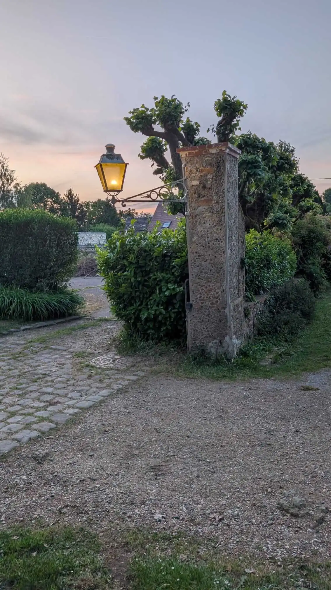

Ce weekend, je suis retourné chez mon beau-père, cette fois pour un dépannage. Depuis plusieurs semaines, le disjoncteur d'abonné de la maison sautait de manière complètement aléatoire et personne ne comprenait pourquoi. J'y suis allé pour chercher la panne, la comprendre et peut-être la réparer. Le coupable est aujourd'hui identifié et mis hors circuit, même si je n'ai pas encore eu le temps de le réparer. Voici comment je m'y suis pris, de la première hypothèse jusqu'au test d'isolement.

## Une panne aléatoire, le pire des scénarios

Dans un dépannage, la panne aléatoire est le pire des scénarios. Un défaut permanent, on peut le provoquer, l'observer et remonter jusqu'à sa cause. Ici, le disjoncteur d'abonné (le disjoncteur général situé juste après le compteur, celui qui coupe toute la maison d'un coup) sautait quand bon lui semblait. On ne peut pas déclencher le problème à la demande pour le tester, il faut donc raisonner autrement.

Mon beau-père avait déjà mené ses propres essais, en faisant tomber certains disjoncteurs pour essayer de cerner le problème. Il n'a rien trouvé. Dans la maison, tout le monde s'est arraché les cheveux à essayer de comprendre d'où ça provenait. Ses différents tests l'orientaient plutôt vers un chauffe-eau. Il en venait même à se demander si le problème ne venait pas du disjoncteur d'abonné lui-même, fatigué par les années.

Pour rappel, il s'agit de la maison où j'avais [remis en service cinq luminaires extérieurs](/blog/2026/05/09/luminaires-exterieurs-maison-beau-pere/) au printemps. L'installation électrique est très ancienne : elle a plus de trente ou quarante ans et sa partie extérieure remonte même aux années 50.

## L'ordre des suspects

Quand un disjoncteur saute sans prévenir, il existe généralement un « ordre des suspects », que l'on passe en revue du plus probable au moins probable.

**En numéro un, l'éclairage extérieur.** C'est la partie la plus exposée d'une installation. La pluie, la condensation, le gel et les écarts de température finissent par avoir raison des joints et des isolants. Dès que l'humidité s'installe dans un luminaire ou dans une boîte de dérivation, elle crée un passage entre les parties sous tension et la terre : une partie du courant s'échappe par là, c'est ce qu'on appelle une fuite. Ce genre de défaut dépend en plus de la météo. Il apparaît un jour de pluie ou un matin de rosée, puis disparaît quand tout a séché, ce qui lui donne précisément cette allure imprévisible.

**En numéro deux, les chauffe-eau.** Leur résistance passe des années à chauffer de l'eau. Avec le calcaire et la corrosion, elle finit par se fissurer ou se percer. Le courant fuit alors vers la cuve, qui est reliée à la terre. Là encore, le défaut ne se montre pas en continu : un chauffe-eau ne chauffe que par moments, souvent la nuit, sans rapport avec ce que font les occupants à cet instant.

Dans ma tête, avant même d'arriver, c'était assez clair : le problème venait des luminaires extérieurs. Tant qu'ils étaient hors service, ils ne risquaient pas de faire disjoncter quoi que ce soit. Depuis le printemps, ils sont de nouveau alimentés et c'est ce qui m'avait mis la puce à l'oreille.

Il y a pourtant une chose que je n'avais pas comprise avant d'être sur place : ce n'est pas le disjoncteur d'abonné qui aurait dû sauter.

## Trois tableaux et pas un seul interrupteur différentiel

Pour savoir où je mettais les pieds, il a fallu comprendre l'installation dans son entier. La maison ne compte pas moins de trois tableaux électriques. Ma première constatation m'a étonné : **il n'y a aucun interrupteur différentiel, nulle part**.

Un interrupteur différentiel, pour ceux qui ne voient pas de quoi il s'agit, compare en permanence le courant qui part dans les circuits et celui qui en revient. S'il en manque une partie (parce qu'elle s'échappe à travers un isolant humide, la carcasse d'un appareil ou, pire, une personne), il coupe. Sur une installation aux normes, son seuil est de 30 mA, une valeur retenue pour protéger les personnes.

Le disjoncteur d'abonné sait lui aussi détecter une fuite, mais avec une sensibilité bien moindre : 500 mA, contre 30 mA. Normalement, c'est donc l'interrupteur différentiel qui réagit le premier, bien avant lui. Il a un autre avantage : il ne fait tomber que la rangée de disjoncteurs qu'il protège, au lieu de couper toute la maison. On sait alors tout de suite dans quelle partie de l'installation chercher.

Chez mon beau-père, ce premier niveau de protection n'existe pas. La moindre fuite remonte jusqu'au disjoncteur d'abonné, qui est le seul à pouvoir la détecter. C'est ce constat qui m'a mis sur la piste d'une fuite de courant plutôt que sur celle d'un disjoncteur fatigué. Il m'a aussi donné une idée de son ampleur. Le seuil du disjoncteur d'abonné est près de dix-sept fois plus élevé que celui d'un différentiel 30 mA : pour le faire réagir, il faut une fuite de plusieurs centaines de milliampères. Autrement dit, **la fuite était flagrante**.

Ce constat dépasse largement la panne du moment. Sans interrupteur différentiel, l'installation n'est clairement pas aux normes. Surtout, les personnes qui vivent dans la maison ne sont pas correctement protégées.

## Ce que cachait cette installation

Il y avait peu de repères au tableau, pour ne pas simplifier les choses. Les circuits de la cuisine et celui sur lequel se trouvait l'éclairage extérieur, justement, n'étaient pas repérés. J'en ai donc profité pour identifier tous les circuits, un à un, afin de comprendre qui fait quoi : les circuits de lumière, les circuits de prises, les départs vers les tableaux divisionnaires. J'ai également ouvert quelques boîtes de dérivation et là, quelle ne fut pas ma surprise. Je m'en doutais un peu, mais j'ai pu constater à quel point l'installation était bancale, voire dangereuse :

- des **neutres en commun** : plusieurs circuits partagent le même fil de neutre. Couper un disjoncteur ne garantit alors plus que le circuit est hors tension, puisque le courant d'un autre circuit peut revenir par ce neutre partagé ;
- des **couleurs mélangées** : dans une boîte de dérivation, un fil rouge devient bleu ;
- une **terre utilisée comme phase** : le fil vert et jaune, réservé à la terre, transporte ici le courant.

Dans une installation pareille, la couleur d'un fil ne veut plus rien dire.

Le repérage des circuits a révélé d'autres joyeusetés, en dehors des boîtes de dérivation.

Au tableau d'abord, les sections de câble ne sont pas respectées. J'ai trouvé des câbles de 2,5 mm² raccordés à un disjoncteur 32 A, alors que cette section doit être protégée par un disjoncteur de 20 A au maximum (pour du 32 A, il faudrait du 6 mm²). Un disjoncteur sert à couper avant que le câble ne chauffe. Ici, le câble peut être traversé par bien plus de courant qu'il n'en supporte sans que rien ne déclenche : c'est une source potentielle d'incendie.

Dans la cuisine ensuite, on s'attend à ce que les deux prises d'un même boîtier double soient sur le même circuit. Eh bien non : à chaque fois, elles dépendaient de deux circuits différents. Pour monsieur Tout-le-Monde, c'est un vrai piège. Avant de démonter une prise double, il aurait pu tester une seule des deux prises, constater qu'il n'y avait plus de courant et y mettre les mains en se croyant en sécurité, alors que l'autre moitié du boîtier était toujours sous tension.

Sur ce genre d'installation, il faut être vraiment prudent. Mon VAT, le vérificateur d'absence de tension, m'a accompagné pendant toute la recherche de panne. Avant de mettre les mains quelque part, je vérifiais fil par fil et prise par prise, y compris là où je pensais être en sécurité.

## L'éclairage extérieur n'avait pas son propre circuit

Pendant tout ce repérage, je gardais dans un coin de ma tête les luminaires que j'avais remis en service. Le défaut ne pouvait pas venir de la boîte de dérivation que j'avais posée à l'extérieur, puisque je l'avais remplie de gel d'étanchéité, justement pour éviter ce genre de problème.

Les luminaires eux-mêmes, c'est une autre histoire. Ils sont anciens et les parois qui protègent la douille et l'ampoule étaient souvent ouvertes, voire tombées, poussées par le vent. Une douille exposée à la pluie, c'est exactement le portrait du suspect numéro un. À ce stade, j'étais quasiment sûr que le problème venait de là.

*L'un des cinq luminaires remis en service au printemps. Ses parois protègent la douille et l'ampoule de la pluie, à condition de rester fermées.*

Pour le vérifier, il fallait isoler l'éclairage extérieur du reste de la maison. C'est là que j'ai découvert le dernier piège de cette installation : **l'éclairage extérieur était sur le même circuit que des prises et des lumières d'une partie de la maison**, le tout mélangé ! Il était donc impossible de le couper seul depuis le tableau. J'ai dû remettre les mains dans ces fameuses boîtes de dérivation (courant coupé et absence de tension vérifiée, comme toujours) pour déconnecter totalement l'éclairage extérieur.

Depuis cette manœuvre, le disjoncteur d'abonné n'a plus sauté. Avec une panne aussi capricieuse, ce calme ne prouvait cependant rien à lui seul. J'ai donc préféré poursuivre mes recherches et aller voir du côté des chauffe-eau, qui restaient des candidats crédibles.

## La valise du désespoir : le chauffe-eau au mégohmmètre

Pour être sûr que le problème ne venait pas de là, j'ai sorti ce que j'aime appeler la « valise du désespoir ». Quand on la sort, on sait qu'on va passer un mauvais moment 😅. Elle contient les outils réservés aux pannes qui sortent de l'ordinaire, dont le mégohmmètre.

C'est avec lui que j'ai procédé à un test d'isolement. Cet appareil applique une tension élevée entre deux points et mesure la résistance qu'il rencontre. Plus elle est grande, mieux c'est isolé.

La méthode est la suivante. Le chauffe-eau est d'abord déconnecté du réseau, bien évidemment. On fait ensuite un pont entre la phase et le neutre, puis on mesure sous 500 V entre ce pont et la terre. Pourquoi ce pont ? Parce que l'on veut s'assurer qu'aucun des conducteurs actifs n'est en contact avec la carcasse du chauffe-eau. En les reliant, on les teste tous les deux en une seule mesure.

Le mégohmmètre a affiché **5,5 MΩ**.

Grâce à la loi d'Ohm, on peut en déduire le courant de fuite du chauffe-eau. Elle s'écrit U = R × I, où :

- U est la tension, soit 230 V ;
- R est la résistance, soit 5,5 MΩ, c'est-à-dire 5 500 000 Ω ;
- I est l'intensité, celle que l'on cherche.

On a donc I = U / R = 230 / 5 500 000 ≈ 0,00004 A. Multiplié par 1 000 pour passer en milliampères, cela donne environ **0,04 mA de fuite**. C'est plus de sept cents fois inférieur au seuil d'un interrupteur différentiel 30 mA et sans commune mesure avec les 500 mA du disjoncteur d'abonné. Le chauffe-eau est sain.

## Le coupable est isolé, pas encore réparé

Le chauffe-eau était hors de cause et le disjoncteur ne sautait plus depuis la déconnexion des luminaires : le coupable était donc bien le circuit d'éclairage extérieur. Je n'ai pas eu le temps de le réparer ce weekend. Je l'ai simplement isolé et déconnecté, pour que tout le reste de la maison puisse fonctionner normalement.

Les prochaines étapes sont déjà claires :

- reprendre les luminaires un par un pour les isoler correctement ;
- surtout, mettre en place des interrupteurs différentiels, pour que les personnes soient enfin protégées.

Pour bien faire, les circuits extérieurs doivent aussi être séparés du reste de l'installation, avec leurs propres disjoncteurs et un interrupteur différentiel dédié. Le jour où l'humidité provoque un défaut dehors, seul l'extérieur tombe et le reste de la maison continue de fonctionner.

## Ce que je retiens de ce dépannage

Une panne intermittente ne se trouve pas en attendant qu'elle se reproduise. Il faut d'abord comprendre l'installation, tableau par tableau et circuit par circuit, puis examiner les suspects dans l'ordre. Mon intuition désignait les luminaires dès le départ, mais c'est la mesure au mégohmmètre qui m'a permis d'écarter le chauffe-eau pour de bon. Une hypothèse, même solide, ne vaut pas une vérification.

L'autre leçon, c'est que le disjoncteur d'abonné n'était pas le problème. On le croyait fatigué alors qu'il était le seul appareil de la maison à signaler la fuite. Le vrai sujet, c'est tout ce qui manque derrière lui : des interrupteurs différentiels 30 mA, des disjoncteurs adaptés à la section des câbles, des circuits séparés et des boîtes de dérivation remises en ordre.

Je retiens enfin qu'une installation comme celle-ci peut piéger n'importe qui, même quand on se croit en sécurité. **En électricité, il faut savoir rester humble face au danger.**

Seule ombre au tableau : les luminaires remis en service au printemps sont de nouveau éteints, le temps que je revienne m'en occuper. 😅 Le reste de la maison, lui, fonctionne sans coupure depuis. C'était le but de ce weekend.

---

*Le premier épisode dans cette maison : [cinq luminaires extérieurs remis en service sur une installation des années 50](/blog/2026/05/09/luminaires-exterieurs-maison-beau-pere/).*

*Vous pouvez suivre la suite sur [LinkedIn]({{ site.linkedin }}) et [Instagram]({{ site.instagram }}). Un disjoncteur qui saute sans raison apparente à Paris ou en petite couronne ? [Contactez-moi](https://www.lartisan20.fr/contact/).*
