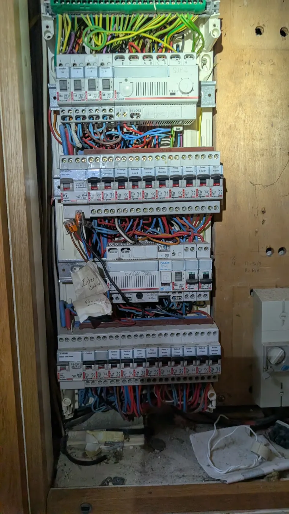
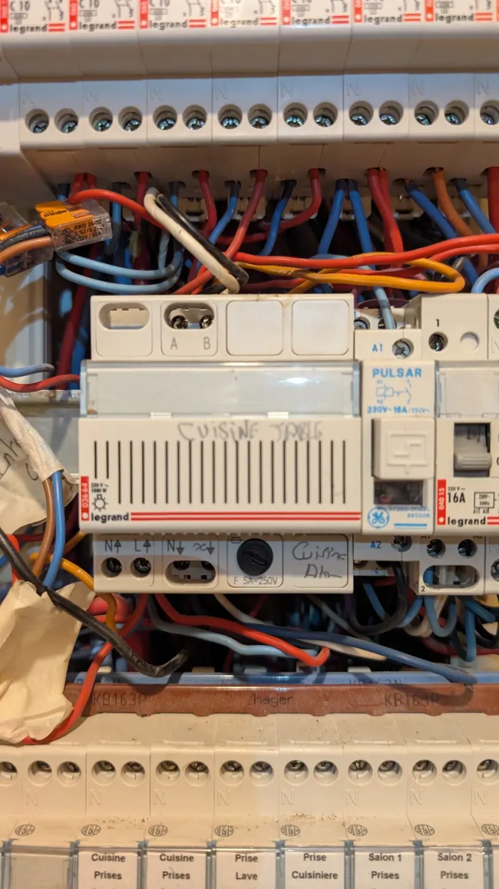
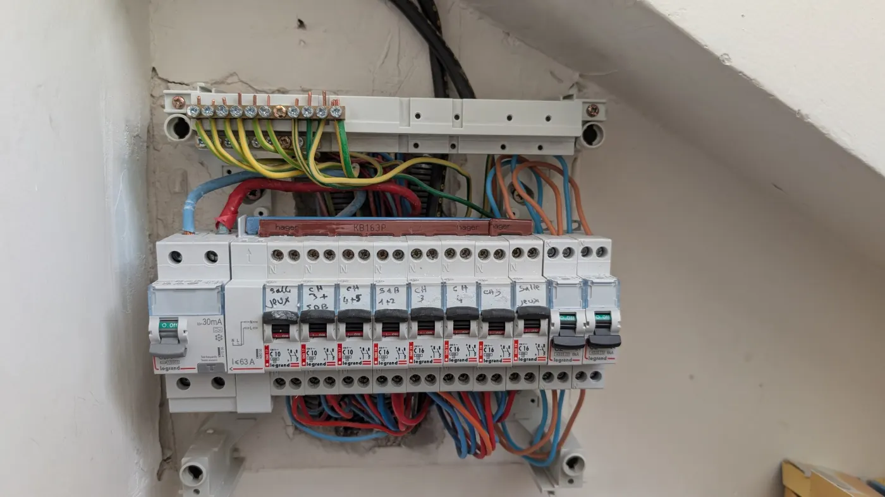
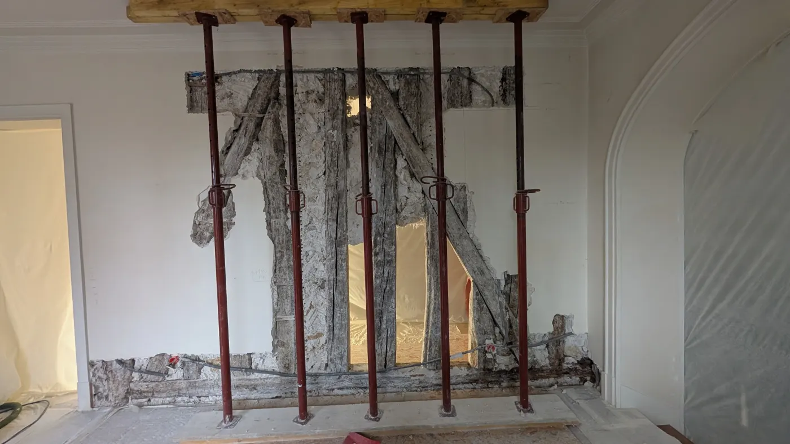
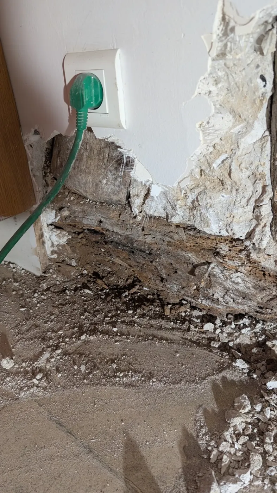

Cette semaine, j'ai passé pas mal de temps sur les chantiers et principalement en électricité. C'est plutôt une bonne nouvelle pour moi : c'est quand même le métier vers lequel je suis en train de me reconvertir !

J'ai commencé dans une grande maison en meulière, en région parisienne. Plus de 300 m², quatre tableaux électriques et pas mal de choses à reprendre. J'y ai passé plusieurs jours à repérer les circuits, faire du tri dans les tableaux et commencer à corriger les premières anomalies.

Ensuite, direction Boulogne-Billancourt pour chercher l'origine d'une panne électrique intermittente dans un appartement. Là aussi, il y avait du travail.

Et pour finir, une surprise qui n'avait rien à voir avec l'électricité : en ouvrant un mur porteur dans la maison, on a découvert une vieille ossature en chêne. Je vous raconte ça à la fin, parce que ça vaut le détour !

## Quatre tableaux électriques dans une maison de plus de 300 m²

J'étais content de pouvoir passer plusieurs jours d'affilée sur de l'électricité. Et il y avait de quoi faire !

Dans cette maison de plus de 300 m², les circuits sont répartis sur quatre tableaux. La première étape a donc été de tout repérer. Concrètement, il faut identifier chaque circuit, un par un, pour savoir quel disjoncteur alimente quoi.

C'est un travail assez long, surtout dans une maison de cette taille. Mais impossible de faire l'impasse dessus : avant de modifier une installation, il faut savoir précisément comment elle est organisée. Sinon, on avance un peu à l'aveugle.

*L'un des quatre tableaux pendant le repérage. Les petites étiquettes permettent d'identifier les fils au fur et à mesure. On distingue notamment un interrupteur différentiel de 25 A en tête de rangée.*

## Un peu de ménage dans les tableaux

Une fois les circuits identifiés, on se rend vite compte qu'une partie de l'installation ne sert plus à grand-chose.

Dans cette maison, plusieurs circuits étaient complètement abandonnés. J'ai donc pu faire du tri et retirer tout ce qui n'avait plus d'utilité.

Il y avait aussi du matériel qui avait fait son temps. Dans l'un des tableaux, j'ai notamment trouvé trois anciens variateurs d'éclairage modulaires. Ils ont été retirés pour revenir à quelque chose de plus classique : du simple allumage ou du va-et-vient, selon les pièces.

Rien de très compliqué sur le principe, mais ça permet déjà d'y voir beaucoup plus clair.

*Un des trois variateurs que j'ai retirés. Celui-ci était identifié « Cuisine Table ».*

Après ce premier nettoyage, il restait à s'attaquer aux choses un peu plus sérieuses. Le repérage avait permis de mettre en évidence plusieurs anomalies dans les tableaux.

## Des interrupteurs différentiels pas vraiment adaptés

La première chose qui m'a sauté aux yeux, ce sont les calibres des interrupteurs différentiels. J'ai trouvé plusieurs modèles en 25 A et en 40 A, dont un 25 A placé en tête d'une rangée complète de disjoncteurs de 10 A et 16 A.

Pour rappel, l'interrupteur différentiel sert à détecter les fuites de courant et à protéger les personnes. Mais son calibre correspond à l'intensité qu'il peut supporter en permanence. Ce n'est donc pas la même chose que la sensibilité de 30 mA, qui concerne la détection des fuites.

C'est un point que j'avais déjà abordé dans [mon article sur le disjoncteur d'abonné qui sautait sans raison](/blog/2026/11/10/le-disjoncteur-d-abonne-qui-sautait-sans-raison/).

Dans cette installation, certains interrupteurs différentiels étaient clairement sous-dimensionnés. J'en ai donc remplacé plusieurs de 25 A par des modèles de 63 A, en appliquant la règle de l'amont : le calibre de l'interrupteur différentiel doit être au moins égal à celui de la protection placée juste avant lui.

Autre problème : certaines rangées comportaient plus de huit circuits derrière un même interrupteur différentiel. Là aussi, il fallait revoir la répartition.

*Après remplacement, avec un interrupteur différentiel de 63 A en tête de rangée. Les circuits sont également repérés directement sur les disjoncteurs.*

## Un sous-tableau alimenté directement depuis le disjoncteur d'abonné

J'ai aussi découvert un câblage assez particulier sur l'un des tableaux divisionnaires.

Celui-ci est alimenté directement depuis le disjoncteur d'abonné, autrement dit l'AGCP, sans disjoncteur de protection dédié au départ dans le tableau principal.

Normalement, un tableau divisionnaire est alimenté depuis un disjoncteur qui protège justement le câble qui part vers ce tableau.

Mais ce n'est pas tout : les deux conducteurs de cette alimentation sont bleus. La phase comme le neutre ! Or, le bleu est réservé au neutre.

On comprend assez vite que cette installation a vécu plusieurs modifications au fil des années.

Malgré les quelques jours passés sur place, il reste donc encore beaucoup de travail. Il faudra probablement envisager [une rénovation bien plus importante](/prestations/renovation-mise-aux-normes/) pour repartir sur de bonnes bases.

## La rénovation électrique, un vrai travail d'enquête

Ce chantier m'a aussi rappelé une chose : intervenir dans l'ancien, ce n'est vraiment pas la même chose que travailler dans le neuf.

La cliente m'a raconté qu'un électricien était déjà venu pour intervenir sur son portail. Il avait finalement préféré repartir, trouvant l'installation trop compliquée et l'ensemble assez chaotique. D'après elle, il était très à l'aise dans le neuf, mais beaucoup moins dans la rénovation.

Je comprends assez bien ce qu'elle voulait dire.

Dans le neuf, on part d'une page blanche. On connaît son installation, on sait où passent les gaines et on construit quelque chose de cohérent dès le départ.

En rénovation, c'est une autre histoire. Il faut d'abord comprendre ce qui a été fait avant nous, parfois à plusieurs époques, avec des modifications successives et des surprises à chaque étape. Et il ne faut surtout pas partir du principe que les couleurs des fils ou les anciens repérages sont forcément fiables.

**C'est presque un travail d'enquête.** Et c'est aussi ce qui rend ces chantiers intéressants.

## À Boulogne-Billancourt, une panne qui ne se manifestait pas tout le temps

Après plusieurs jours dans la meulière, changement de décor avec un appartement à [Boulogne-Billancourt](/electricien-boulogne-billancourt/).

Cette fois, il s'agissait d'une [recherche de panne](/prestations/depannage-electrique/) : le différentiel sautait de temps en temps, sans raison apparente.

C'est amusant, parce que c'est déjà la deuxième panne intermittente que je rencontre en peu de temps. J'avais eu un cas similaire dans la maison de mon beau-père.

La difficulté avec ce genre de problème, c'est qu'au moment où on arrive, tout peut fonctionner parfaitement. Il faut donc prendre le temps de chercher et de contrôler les différents points de l'installation.

## Des dominos oxydés derrière la panne

J'ai commencé par ouvrir plusieurs prises, notamment dans la cuisine. Et c'est finalement au niveau du raccordement du four et de la plaque de cuisson que j'ai trouvé quelque chose d'intéressant.

Les deux appareils étaient raccordés avec des dominos. Les câbles de 6 mm² étaient oxydés et leur isolant était complètement abîmé à certains endroits, presque rongé.



*Le raccordement qui posait problème : des conducteurs oxydés et un isolant très dégradé.*


Ce n'est pas vraiment rassurant, surtout pour des appareils aussi gourmands en électricité que le four et la plaque de cuisson.

Une mauvaise connexion peut provoquer un échauffement important. Et avec un isolant aussi dégradé, le risque de défaut électrique est bien réel. Cela peut notamment expliquer le déclenchement du différentiel.

J'ai donc remplacé les portions de câble endommagées et refait les connexions avec des bornes Wago adaptées.

C'est quand même plus propre et plus pratique à contrôler !

## Un nouveau tableau électrique pour l'appartement

Tant qu'à intervenir sur l'installation, nous avons également discuté avec la cliente du remplacement du [tableau électrique](/prestations/remplacement-tableau-electrique/).

J'ai donc remplacé le disjoncteur d'abonné et installé un nouveau coffret Schneider Resi9 XE de 13 modules, sur une rangée. C'est la même gamme que celle que j'avais utilisée pour [l'atelier de poterie dans l'Orne](/blog/2026/05/30/atelier-poterie-orne-installation-electrique-complete-four/).



*Le nouveau coffret Schneider Resi9 XE après installation.*


Et comme sur le premier chantier, impossible d'échapper au repérage des circuits ! Il a fallu identifier les départs pour pouvoir tout raccorder correctement dans le nouveau tableau.

C'est finalement un bon résumé de ma semaine : beaucoup de repérage, un peu de nettoyage et pas mal de remise en ordre.

## La surprise derrière le mur porteur

Je vous avais promis une dernière anecdote. Elle se passe dans la maison en meulière, mais cette fois, on s'éloigne un peu de l'électricité.

En début de semaine, avant de commencer le travail sur les tableaux, nous avions attaqué l'ouverture d'un mur porteur pour y créer une fenêtre.

Le projet était de poser un IPN, un profilé métallique qui permet de reprendre les charges du mur après ouverture. Jusque-là, rien d'extraordinaire. On s'attendait à trouver un mur maçonné classique, comme on en rencontre souvent dans ces maisons en pierre meulière.

Sauf qu'en ouvrant le mur, on a découvert tout autre chose : une véritable ossature en chêne !

Les poutres font environ 30 cm sur 20 de section et sont espacées de 40 cm. On avait donc une structure en bois assez impressionnante, un peu comme ce qu'on pourrait trouver dans une maison normande. Pas vraiment ce à quoi on s'attendait en région parisienne !

*Une fois le mur ouvert, on découvre l'ossature en chêne derrière l'enduit. Le tout est maintenu par des étais pendant les travaux.*

Forcément, la découverte a un peu inquiété la cliente. Ce n'était pas prévu au programme et cela impliquait un surcoût. Elle a même envisagé d'arrêter les travaux.

Mais en regardant de plus près, on a compris que cette découverte était finalement une bonne chose.

Au pied du mur, une grosse poutre horizontale en chêne était complètement rongée par l'humidité. Le bois était tellement dégradé qu'**on pouvait littéralement le creuser avec les doigts**.

*La poutre au pied du mur. Le bois est tellement attaqué par l'humidité qu'il part en miettes.*

Et surtout, cela permettait de comprendre l'origine des fissures présentes dans la maison. Sans cette ouverture, personne n'aurait probablement découvert l'état de cette poutre avant un bon moment.

Le projet a donc dû être adapté. La solution envisagée consiste à mettre en place des renforts métalliques pour former un cadre, puis à ouvrir la partie intérieure afin d'installer la fenêtre comme prévu.

Point important : cette solution technique a dû être validée par un ingénieur structure. On parle d'un mur porteur et on ne rigole pas avec ce genre de situation.

C'est aussi ça, la rénovation : on pense savoir ce qu'on va trouver et parfois le chantier nous raconte une tout autre histoire.

## Ce que je retiens de cette semaine

Deux chantiers, deux ambiances complètement différentes.

D'un côté, une grande maison avec quatre tableaux électriques et des années de modifications à comprendre. De l'autre, un appartement avec une panne intermittente, un raccordement dégradé et un tableau à remplacer.

Mais dans les deux cas, la première étape a été la même : prendre le temps de repérer et de comprendre l'existant avant d'intervenir.

Ce n'est peut-être pas la partie la plus spectaculaire du métier, mais c'est probablement l'une des plus importantes.

Et puis il y a eu cette histoire de mur porteur et de poutre en chêne. Une bonne piqûre de rappel sur les surprises que peuvent réserver les bâtiments anciens. Quand on intervient dans une maison, on ne sait jamais vraiment ce qui se cache derrière les murs.

En tout cas, j'ai pris beaucoup de plaisir sur ces différents chantiers. Et si je devais choisir, je crois que je ne serais pas contre quelques semaines supplémentaires avec autant d'électricité au programme !

La reconversion suit son chemin. 😅

---

*Pour suivre mes prochains chantiers et mes aventures dans cette reconversion, retrouvez-moi sur [LinkedIn]({{ site.linkedin }}) et [Instagram]({{ site.instagram }}). Vous avez un tableau électrique à remplacer ou une panne à rechercher à Paris ou en petite couronne ? [Contactez-moi](https://www.lartisan20.fr/contact/).*
